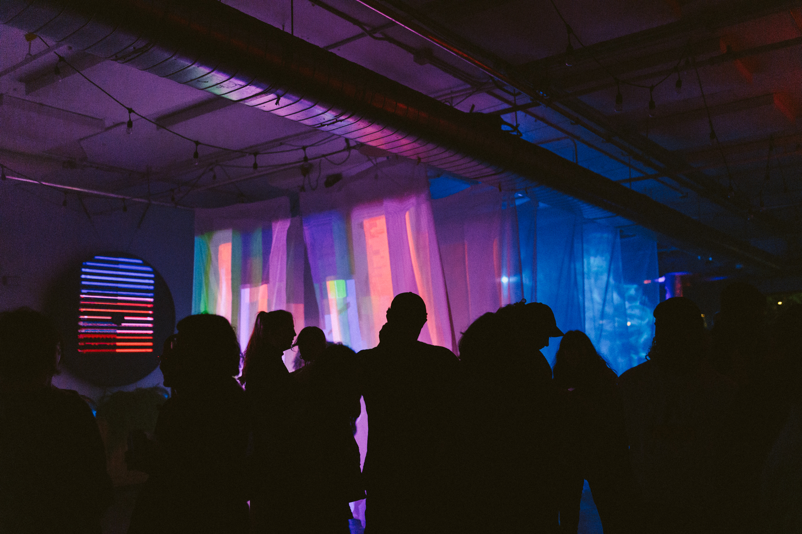
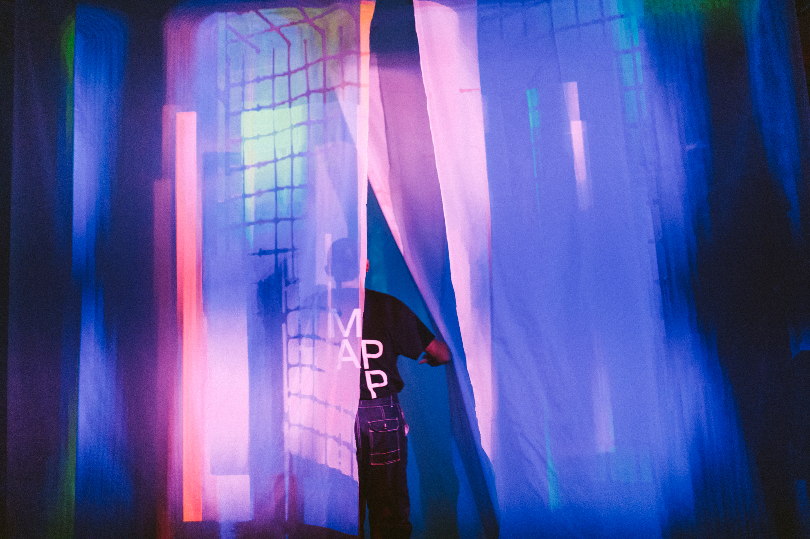
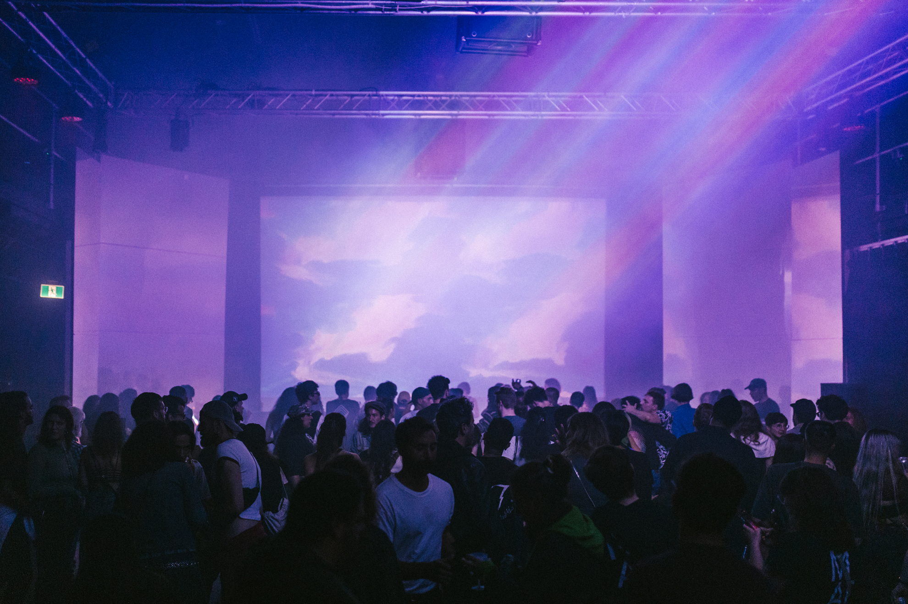

In September 2024 I had the opportunity to be apart of the people who worked on the closing party of the MAPP_MTL festival which took place on September 29th 2024 at Moment Factory.

I have worked on multiple aspects of the event from creative works (3D and compositing) to interaction design and mapping.

The visuals on these drapes were made by⠀[Anamika Deb](https://www.instagram.com/debstudio.co/)⠀while the surface was mapped by me and⠀[Bonnie Pham](https://www.instagram.com/bonnie2.0.0/)⠀

I've also collaborated on a VJ set with Maxime Simmard.

`⠀Photography provided by MAPP_MTL⠀`